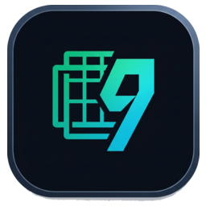

<div align="center">



# v9 MultiRLBX

### Lightweight Roblox Multi-Account Launcher, Smart Eco Optimizer & `.v9m` Macro Studio for Windows

[](VERSION)
[](#requirements)
[](docs/BUILD.md)
[](#security--privacy)
[](LICENSE)

*Created by **[v9pv](https://github.com/nielopek364-netizen/)** · Bilingual **PL / EN** Workspace · Zero DLL Injection · Zero Telemetry*

<p>
  <a href="#quick-start">Quick Start</a> ·
  <a href="#why-v9-multirlbx">Why v9 MultiRLBX</a> ·
  <a href="#core-features">Features</a> ·
  <a href="#hotkeys--shortcuts">Hotkeys</a> ·
  <a href="#security--privacy">Security</a> ·
  <a href="#faq">FAQ</a>
</p>

</div>

---

> **v1.0.0 Initial Release**: Built from the ground up as a fast, zero-bloat Windows utility for managing multiple Roblox clients simultaneously, optimizing background CPU/RAM usage, automating farms with `.v9m` macros, and keeping sessions protected locally.

---

## Quick Start

Get up and running in under 30 seconds. **No Visual Studio, .NET SDK, or NuGet packages required.**

1. **Download** the latest release or clone the repository:
   ```cmd
   git clone https://github.com/nielopek364-netizen/v9-MultiRLBX.git
   cd v9-MultiRLBX
   ```
2. **Double-click `Run.bat`**:
   - On first launch, Windows automatically compiles `v9 MultiRLBX.exe` using the built-in `.NET Framework 4.x` (`csc.exe`) compiler and launches the desktop workspace.
3. **Optional Desktop Shortcut**:
   - Run `installer\Install.bat` to install under `%LOCALAPPDATA%\Programs\MultiRLBX` with Desktop + Start Menu shortcuts (no Administrator rights required).

---

## Why v9 MultiRLBX?

| Pillar | What It Means for You |
| :--- | :--- |
| **Zero Injection & Protocol-Safe** | Holds `ROBLOX_singletonMutex` externally and launches clients strictly via the official `roblox-player:` URI protocol. Never modifies or injects into Roblox binaries. |
| **100% Localhost Privacy** | Embedded UI server (`LocalUiServer.cs`) binds strictly to `127.0.0.1` (`IPAddress.Loopback`) with an ephemeral per-session 144-bit token. Zero telemetry, zero external trackers. |
| **Zero-SDK Native Build** | Clean C# 5 engine compiles directly on any Windows 10/11 machine with built-in `csc.exe`, producing a single lightweight executable with custom icon & DPI manifest. |
| **Built for 24/7 Farming** | Combines Smart Eco FPS/CPU/RAM throttling, Watchdog + Error 277 Auto-Reconnect, cyclic Farm Scheduler, and macro-safe Anti-AFK in one workspace. |

---

## Core Features

### 1. 1-Button Login Hub & Account Manager (`WebAuth.cs`, `Api.cs`, `QrCode.cs`)
- **5 Sign-In Methods in One Modal**:
  - **QR Code & 6-Char Quick Login**: Scan directly in Roblox Mobile or confirm in browser.
  - **Isolated Chromium Web Login**: Opens a clean temporary profile (`Edge` / `Chrome` / `Brave`) and captures `.ROBLOSECURITY` via loopback DevTools without logging out existing sessions.
  - **`.ROBLOSECURITY` Paste**: Extracts valid tokens automatically from raw text blocks.
  - **Bulk `.txt` Import**: Parses `username:password:cookie` lists in one step.
  - **JSON Extension Import**: Supports Cookie-Editor and EditThisCookie `.json` exports.
- **Live Presence & Batch Cookie Checks**: Concurrency-limited `SemaphoreSlim` cookie validation plus batch `InGame` / `Website` / `Offline` Presence status.
- **Groups, Aliases & Searchable Tags**: Organize large alt farms cleanly and launch batches with configurable per-account delay (`LaunchDelaySec`) and FPS caps.

### 2. Smart Eco, RAM Cleaner & Window Tiling (`MaxAlts.cs`, `MemClean.cs`, `WindowLayout.cs`)
- **Smart Eco Engine**: Single PID enumeration per tick, background FPS throttling, Windows EcoQoS + Idle priority, optional CPU core affinity pinning, and a configurable working-set trim floor (`MaxAltsTrimMinMb`).
- **Auto-Tile & Borderless Grid**: Automatically arranges launched Roblox windows into `Auto`, `Grid`, or `FixedSize` layouts across chosen monitors with custom gap, margin, and borderless mode.
- **FastFlags (`Gfx.cs`)**: Live `ClientAppSettings.json` generator with `Default`, `Low`, `Potato`, `Ultrapotato`, and `Custom` profiles plus `D3D11` / `Vulkan` / `OpenGL` selection.
- **Server Browser (`Api.cs`)**: Browse public servers sorted by lowest or highest player count, inspect server FPS & ping color badges, and copy or bind `Job ID` in one click.

### 3. 24/7 Farm Protection & Scheduler (`AntiAfk.cs`, `Launcher.cs`, `AppEngine.cs`)
- **Macro-Safe Anti-AFK**: Periodic Keep-Alive pulses (`Nudge`, `Space`, `Zoom`) that automatically pause while recording or playing `.v9m` macros, plus a manual **Run Anti-AFK Pulse Now** button.
- **Watchdog & Auto-Reconnect (Kick / Error 277)**: Detects crashed processes, `Disconnected` / `Crash` dialogs, and prolonged Presence drops to automatically rejoin the target `PlaceId` / `JobId`.
- **Crash Breaker & Ghost Killer**: Prevents infinite restart loops during outages and cleans up hung headless clients.
- **Farm Scheduler**: Configure cyclic restarts every `X` hours and daily `HH:mm` auto-start / auto-stop windows for all accounts or a specific group.

### 4. `.v9m` Macro Studio (`MacroForm.cs`, `Macro.cs`)
- **Floating Always-On-Top Recorder**: Trigger **F9** (Record / Stop) and **F10** (Play / Stop) from anywhere while in-game.
- **Humanized Playback**: Adjustable playback speed (`0.1x` to `100x`), repeat count, loop pause (`ms`), continuous loop toggle, leading-idle trimming, mouse-move toggle, timing/pixel jitter (`jitterMs`, `jitterPx`), and target window focusing.
- **Human-Readable `#v9m 2` Format**: Easy to inspect, share, and edit. Full specification in [docs/MACROS.md](docs/MACROS.md).

### 5. Encrypted `.v9vault` Backup, Updater & Optional Webhooks (`Store.cs`, `Updater.cs`, `Webhook.cs`)
- **Local Vault Encryption**: Accounts are encrypted at rest with **Windows DPAPI** (`CurrentUser`) or portable password mode (**PBKDF2-SHA1 100,000 iterations + AES-256-CBC + HMAC-SHA256**).
- **One-Click `.v9vault` Backup**: Export and restore your entire encrypted account vault and settings in one portable file before reinstalling Windows or moving PCs.
- **On-Demand GitHub Update Check**: Check for new releases at `github.com/nielopek364-netizen/v9-MultiRLBX` straight from Settings.
- **Optional HTTPS Webhooks**: Opt-in crash, batch, and HTTP 403 alerts queued safely with `SemaphoreSlim` and `429 Retry-After` backoff.

---

## Hotkeys & Shortcuts

Global Windows hotkeys can be toggled in **Settings** (`GlobalHotkeys`), and macro hotkeys work inside the floating Macro Studio window:

| Shortcut | Action | Scope |
| :--- | :--- | :--- |
| `Ctrl + Shift + T` | **Auto-Tile** all active Roblox windows | Global Windows |
| `Ctrl + Shift + M` | **Clean RAM** across Roblox processes | Global Windows |
| `Ctrl + Shift + K` | **Panic Stop All** running Roblox instances | Global Windows |
| `F9` | **Record / Stop** `.v9m` macro | Macro Recorder |
| `F10` | **Play / Stop** `.v9m` macro | Macro Recorder |

---

## Security & Privacy

- **Localhost Only**: The desktop UI (`ui/app.html`) runs on `127.0.0.1` only with a random 144-bit session token injected at startup. No LAN listeners, no open firewall ports.
- **Zero Telemetry**: No analytics, no crash uploads, no background phone-home connections. Network calls occur only when you explicitly verify cookies/Presence, fetch servers, scan a QR code, test a webhook, or click **Check GitHub**.
- **Clean First-Run Experience**: Launches straight into the dashboard with an optional 4-step **Quick Guide** (`PL / EN`) accessible anytime from the sidebar.

---

## Repository Layout

```text
v9-MultiRLBX/
├── Run.bat                 # Auto-builds (if needed) and launches v9 MultiRLBX.exe
├── Build.bat               # Direct .NET Framework 4 csc.exe compiler script
├── Publish-GitHub.bat      # One-click Git init, clean stage, tag & GitHub push
├── app.ico / app.manifest  # Custom multi-res icon & DPI/UAC manifest
├── src/                    # Thread-safe C# 5.0 engine, shell, security & macro modules
├── ui/app.html             # Embedded single-file desktop UI (Dark/Light, 5 accents, PL/EN)
├── scripts/                # Cross-platform GitHub publishing scripts (.ps1 / .sh)
├── docs/
│   ├── BUILD.md            # Compilation, Windows installer & GitHub Actions CI guide
│   ├── SETTINGS.md         # Architecture, Smart Eco, FastFlags & .v9vault reference
│   └── MACROS.md           # #v9m 2 macro format & local API specification
├── installer/
│   ├── Install.bat         # Per-user shortcut & Add/Remove Programs setup
│   ├── install.ps1         # PowerShell installer script
│   ├── uninstall.ps1       # Clean uninstaller
│   └── MultiRLBX.iss       # Inno Setup 6+ installer script
└── .github/                # CI release workflow, branding assets & issue/PR templates
```

---

## FAQ

<details>
<summary><strong>Does v9 MultiRLBX inject DLLs or modify Roblox client files?</strong></summary>
<p>No. Multi-instance launching works cleanly via the standard <code>ROBLOX_singletonMutex</code> and official <code>roblox-player:</code> URI protocol. FastFlags only write standard <code>ClientAppSettings.json</code> graphics preferences.</p>
</details>

<details>
<summary><strong>Why don't I need Visual Studio or the .NET SDK to build it?</strong></summary>
<p>Windows 10 and 11 ship with the <code>.NET Framework 4.x</code> compiler (<code>csc.exe</code>) pre-installed. <code>Build.bat</code> and <code>Run.bat</code> target C# 5.0 directly using system assemblies with zero third-party packages.</p>
</details>

<details>
<summary><strong>How do I back up my accounts before reinstalling Windows?</strong></summary>
<p>Open <strong>Settings</strong>, enter an encryption password under <strong>Encrypted .v9vault Backup</strong>, and click <strong>Export .v9vault</strong>. On your new PC, click <strong>Import .v9vault</strong> with the same password to restore everything safely.</p>
</details>

<details>
<summary><strong>Will Anti-AFK interfere with my .v9m macros?</strong></summary>
<p>No. The Anti-AFK engine automatically pauses keep-alive pulses whenever a <code>.v9m</code> macro is recording or playing.</p>
</details>

---

## Requirements & Documentation

- **OS**: Windows 10 or Windows 11 (64-bit / 32-bit)
- **Compiler**: Pre-installed Windows `.NET Framework 4.x` (`csc.exe`)
- **Desktop Shell**: Microsoft Edge or Google Chrome (falls back to default browser)

Further reading:
- **[Build & Installation Guide](docs/BUILD.md)**
- **[Settings & Architecture Reference](docs/SETTINGS.md)**
- **[Custom `.v9m` Macro Format](docs/MACROS.md)**
- **[Security Policy](SECURITY.md)** · **[Contributing](CONTRIBUTING.md)** · **[Changelog](CHANGES.md)**

---

## Author & License

- **Author**: **v9pv** ([github.com/nielopek364-netizen](https://github.com/nielopek364-netizen/))
- **License**: GNU General Public License v3.0 ([LICENSE](LICENSE))

If **v9 MultiRLBX** saves you time and RAM, consider giving the repository a **Star** on GitHub!

*Independent open-source utility; not affiliated with, endorsed by, or sponsored by Roblox Corporation.*
